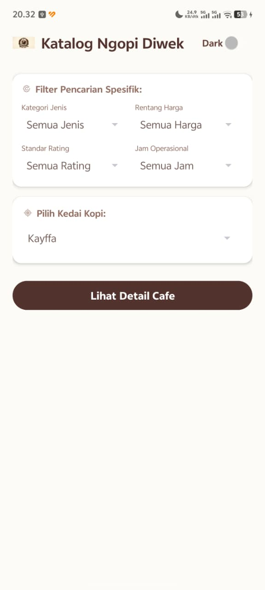
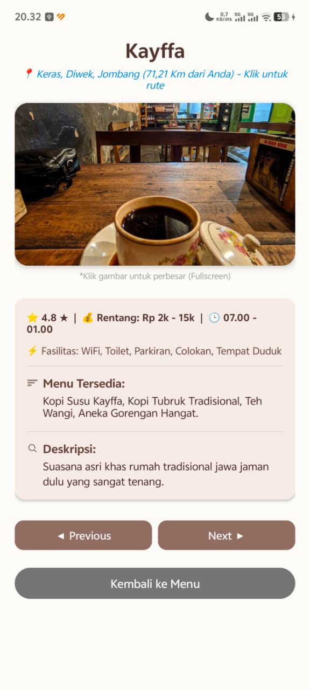

# Aplikasi-Katalog-Tempat-Ngopi-di-Diwek
Aplikasi mobile berbasis Android untuk menyajikan katalog referensi tempat ngopi beserta informasi detail fasilitas dan titik lokasi di wilayah Diwek, Jombang.

# Aplikasi Katalog Tempat Ngopi di Kecamatan Diwek Berbasis Android
*(Proyek Akhir Semester - Workshop Pemrograman Lanjut | Politeknik Elektronika Negeri Surabaya)*

## 📝 Deskripsi Proyek
Proyek pemrograman lanjut ini merealisasikan sebuah aplikasi mobile native berbasis Android untuk menyajikan direktori referensi kedai kopi lokal di wilayah Diwek, Jombang. Aplikasi ini dibangun untuk mempermudah mobilisasi pengguna dalam menemukan tempat nugas, belajar kelompok, atau berkumpul yang sesuai dengan preferensi kriteria spesifik secara instan.

## 👷 Kontribusi Spesifik Saya (My Role)
Dalam proyek *software development* mandiri ini, saya bertanggung jawab penuh pada seluruh siklus pengembangan sistem (*Full-Cycle Mobile Developer*):
- **Arsitektur Kode & Data:** Mengimplementasikan pengorganisasian struktur data katalog lokal menggunakan bahasa pemrograman **Java** dan Android SDK di platform **Android Studio**.
- **Perancangan UI/UX:** Mendesain tata letak antarmuka komponen visual menggunakan file tata letak XML secara responsif, memastikan transisi perpindahan halaman detail menu tetap konsisten dan tidak acak-acakan.
- **Integrasi Sensor & Fitur:** Menyusun algoritma pemindaian parameter input serta menghubungkannya dengan API layanan lokasi (GPS) internal perangkat.

## ⚡ Fitur Utama & Logika Pemrograman
- **Pencarian 4 Filter Sekaligus:** Menggunakan kontrol logika kondisional sekuensial untuk menyaring data kafe berdasarkan kombinasi Kategori Jenis, Rentang Harga, Standar Rating, dan Jam Operasional secara simultan.
- **Kalkulasi Jarak Otomatis (GPS):** Mengintegrasikan pembacaan koordinat posisi perangkat pengguna secara *real-time* untuk menghitung jarak kilometer secara otomatis menuju titik lokasi kafe terdekat.
- **Aksesibilitas Dual-Mode:** Menyediakan tombol *Toggle Switch Mode* untuk mengubah tampilan antarmuka secara instan antara Mode Terang (*Light Mode*) dan Mode Gelap (*Dark Mode*).

## 📷 Dokumentasi Antarmuka Aplikasi
*(Unggah tangkapan layar visual aplikasi Anda ke dalam repositori ini)*
- **Halaman Filter Utama:**  
  
- **Halaman Detail Informasi Kafe:**  
  
